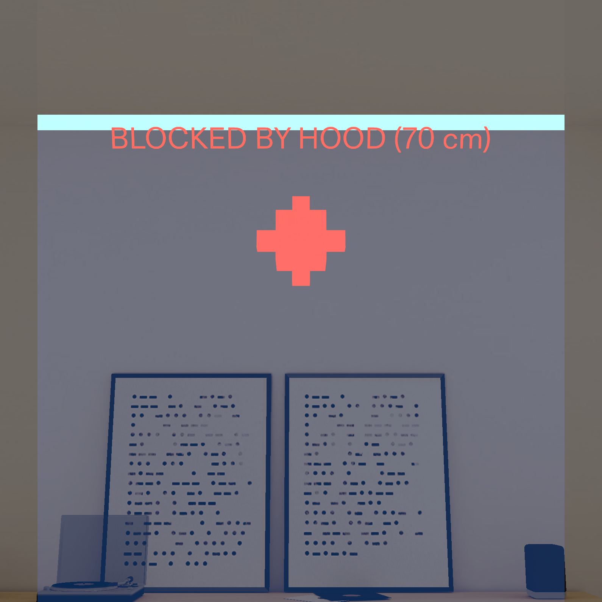
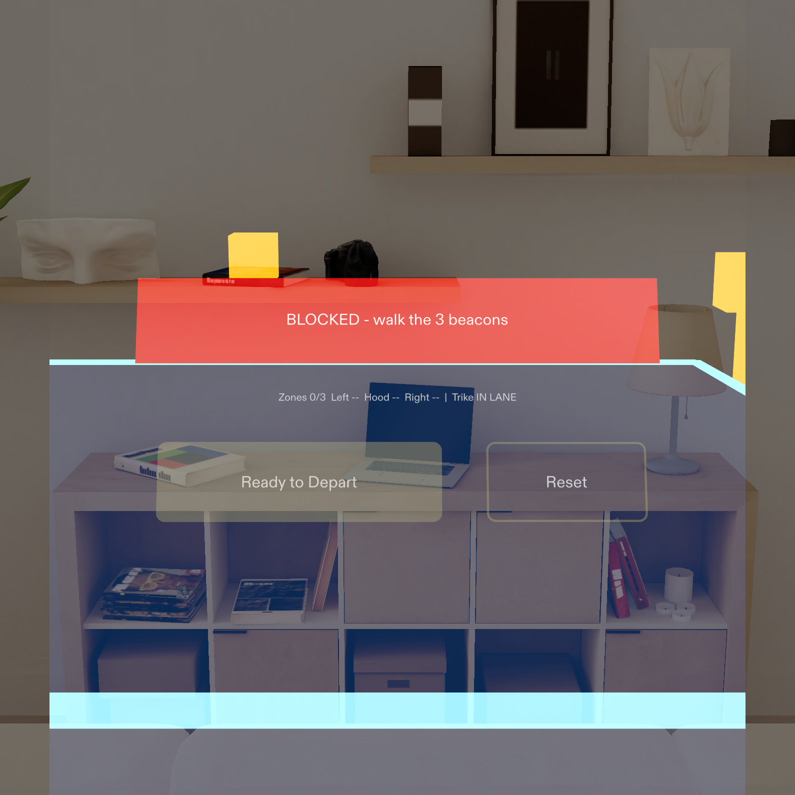
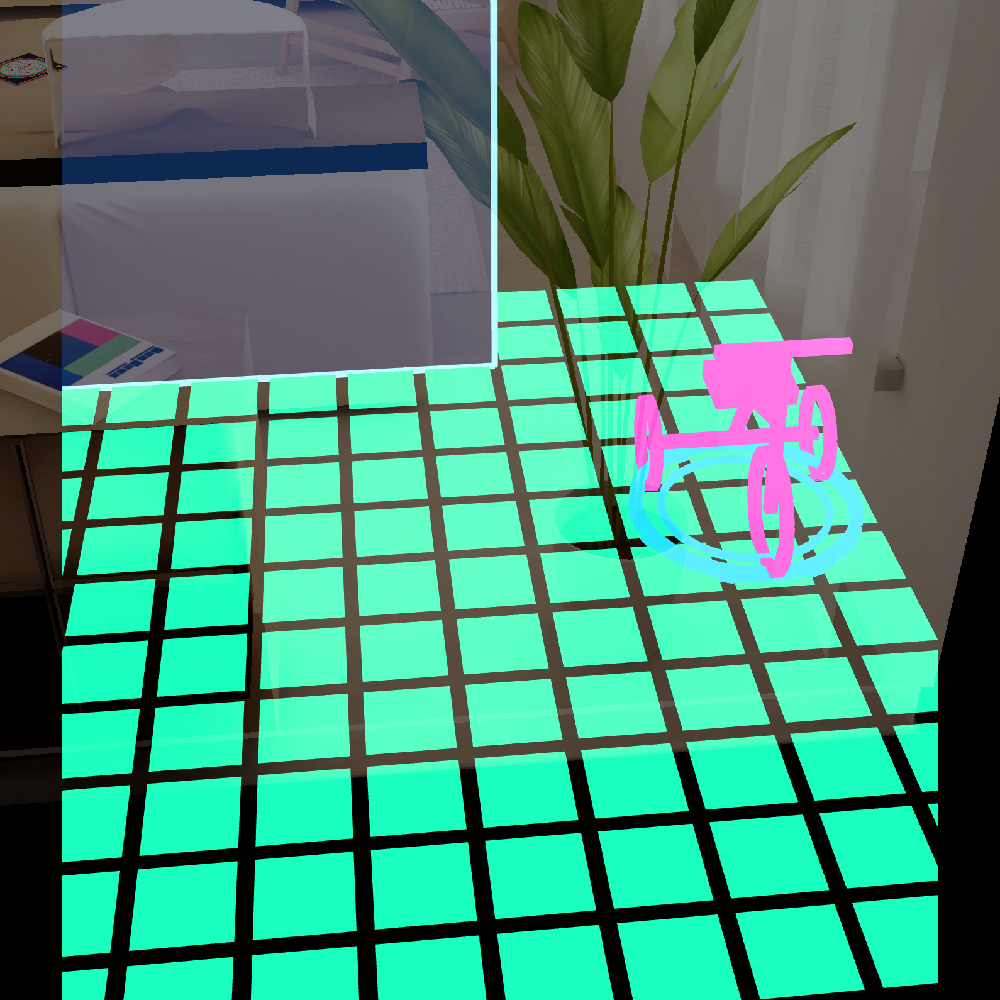
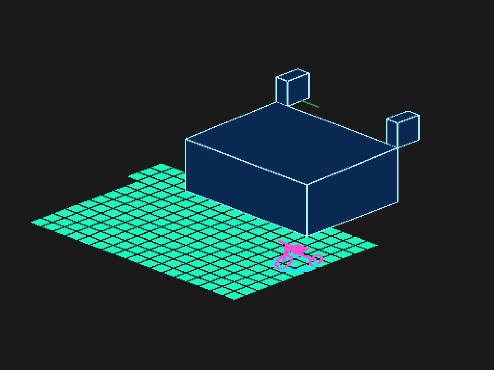

# Circle Check+ — 1:1 AR Front Blind-Spot & Walkaround Safety Trainer for Snap SPECS

**Circle Check+** puts a 1:1 scale luminous SUV/light-truck front cab directly on your room floor so you can physically test **sightline reciprocity** with your own eye height and walk a real **pre-departure Circle Check** using Snap SPECS's `37° × 32°` field of view.

Built from scratch as a clean-room submission for **Learn AR with SPECS (Round 2)** on **Lens Studio 5.25.0** with **InteractionKit 4.0**, **UIKit 4.0**, and **LEAF 4.0**.

---

## The Three-Act Spatial Experience

| Act 1: Stand vs. Crouch Reciprocity | Act 2: Blocked Departure & Guard | Act 3: 3-Zone Sweep & Tricycle Clearance |
|---|---|---|
|  |  |  |

1. **Act 1 — Sightline Reciprocity (`160 cm` vs. `70 cm`)**: Stand `100 cm` ahead of the 1:1 front bumper (`x = -45, z = +100 cm`). At `160 cm` adult eye height, the live green ray connects directly to the driver's eye point (`SIGHTLINE CLEAR`). Crouch (`Q/E`) to `70 cm` toddler height — the grazing sightline over the `112 cm` bumper lip sits at `y ≈ 91.5 cm`, snapping the ray against the sloped hood with an `8 cm` red 3D cross hit marker (`BLOCKED BY HOOD`).
2. **Act 2 — Blocked Departure & Through-Hood Drag Guard**: Step into the driver seat (`(-45, 152, -195 cm)`) to reveal the low cabin dashboard strip behind the hood trailing edge (`z = -152 cm`). Pressing `Ready to Depart` before inspection turns the status banner crimson (`BLOCKED - walk the 3 beacons`) and lights 3 golden `110 cm` walkaround beacons. Attempting to grab the hidden `50 cm` child tricycle through the hood from the seat is refused at the product interaction gate (`OUT_OF_REACH`, position unchanged at `(+15, 0, +55 cm)`).
3. **Act 3 — Strict Forward `-Z` Frustum Walkaround & Safe-Ring Clearance**: Walk around the vehicle front (`WASD`) sweeping SPECS's `37° tall × 32° wide` forward `-Z` frustum across `FrontLeftAPillar`, `FrontCenterHood`, and `FrontRightAPillar`. Each zone flips from bright orange-red to cyan-green at `>= 60%` unoccluded coverage. Stand within `150 cm` unoccluded of the neon-pink child tricycle, single-hand Y-locked drag it into the glowing cyan Safe Parking Ring (`(+150, 0, +70 cm)`, `r = 25 cm`), and return to the driver seat to press `Ready to Depart` (`CLEARED - safe to depart`).



---

## Architecture & Single Geometry Source

- **Pure Engine-Independent Spatial Core (`Assets/Scripts/Core/`)**:
  - [VehicleGeometrySpec.ts](/Assets/Scripts/Core/VehicleGeometrySpec.ts): Deeply frozen 1:1 canonical SUV front occluders (`200 cm` wide, bumper `y = 0..112 cm` at `z = 0`, sloped hood rising to `y = 118 cm` at `z = -150 cm`, left/right A-pillars `y = 118..172 cm`, driver eye `(-45, 152, -195 cm)`), symmetric segment-triangle raycasting (`traceSightline` / `isLineOfSightClear`), and boot-time `18 × 18` (`20 cm`) footprint classification (`748` static floor vertices, `< 1,500` budget, zero per-frame mesh rebuilds).
  - [CircleCheckCore.ts](/Assets/Scripts/Core/CircleCheckCore.ts): Pure state machine (`createInitialState`, `step`, `getDebugSnapshot`) enforcing single-threshold driver-seat detection, strict `-Z` rectangular `37° × 32°` frustum & occlusion honesty, reach/occlusion-guarded tricycle drag with keepout clamping and Safe Ring snap, and pure derived departure selectors (`CLEARED` immediately reverts to `IDLE` on lane re-entry, seat exit, or `Reset`).
- **Lens Studio 5.25.0 Scene & Interaction Layer (`Assets/Scripts/`)**:
  - Renders occluder meshes (`DepthWrite: true` + bright luminous cyan wireframes for additive optics), live sightline beam + `8 cm` red cross hit marker, static 3-zone floor meshes, `UIKit 4.0` cabin dashboard, `InteractionKit 4.0` Y-locked single-hand tricycle drag, and procedural spatial audio feedback directly from `VehicleGeometrySpec` with zero duplicated geometry `@input` constants.
  - Because `DeviceTracking (World)` overwrites direct camera `setWorldPosition` on the next frame in `SPECS 27` Preview (verified by the Ticket 01 probe), automated `LEAF` runs position `VehicleRoot` inversely so manual `WASD` and `LEAF` share the exact same `camLocalPos` pipeline with zero test-only bypass flags.

---

## Verification Matrix: Logic Proven vs. Feel Unproven

| Area | Status | Evidence |
|---|---|---|
| **Spatial math, reciprocity (`P1`), departure safety (`P3`), strict `-Z` frustum (`P4`)** | **Logic Proven** | Offline `npm test` (`Vitest + fast-check` Conditional PBT + Role 3 mutation calibration): **17 / 17 PASSED**, `tsc --noEmit -p tsconfig.core.json`: **0 errors** |
| **Live 3-Act flow, through-hood drag guard & cross-run `Reset`** | **Logic Proven** | Lens Studio `5.25.0` `SPECS 27` Interactive Preview `LEAF 4.0` (`fail-fast`, `__leaf__diagnostic_report_duration_ms = 0`): **3 / 3 PASSED** (`act1-sightline-reciprocity`, `act2-blocked-departure-guard`, `act3-walkaround-trike-depart`) + consecutive `act3` re-run PASSED |
| **Manual camera + simulated hand walkaround** | **Logic Proven** | Verified in `SPECS 27` Interactive Preview with live single-line `getDebugSnapshot()` transition logs and 75 sequential preview captures |
| **Physical SPECS waveguide brightness, optical hand-tracking comfort & real-room crouch ergonomics** | **Feel Unproven** | No physical SPECS hardware available; only testable on real glasses |

---

## Quick Start & Reproducing Verification

### 1. Offline Spatial Core & Property-Based Tests (No Lens Studio Required)

```bash
npm install --no-package-lock
npm test
npm run typecheck
```

### 2. Open & Run in Lens Studio 5.25.0

1. Open `specs-circle-check.esproj` in **Lens Studio 5.25.0** (Apple Silicon or Intel).
2. In the Preview panel, select **Interactive Preview** and device **SPECS 27**.
3. Walk around with `WASD`, crouch/stand with `Q`/`E`, look with right-drag, and pinch-click to press `Ready to Depart` / `Reset` or drag the neon-pink child tricycle into the cyan Safe Parking Ring.
4. To run the automated `LEAF 4.0` suite, open the LEAF panel and run `act1-sightline-reciprocity`, `act2-blocked-departure-guard`, and `act3-walkaround-trike-depart` (all registered in `LeafIndex.ts`).

---

## Project Artifacts & License

- [Design Brief (plan-lens approved)](/devpost/design-brief.md)
- [Devpost Submission Writeup](/devpost/DEVPOST_SUBMISSION.md)
- Licensed under the [MIT License](/LICENSE).
