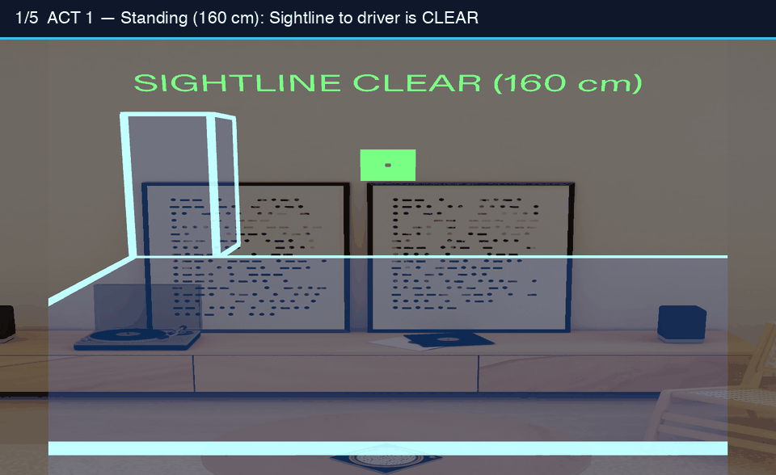
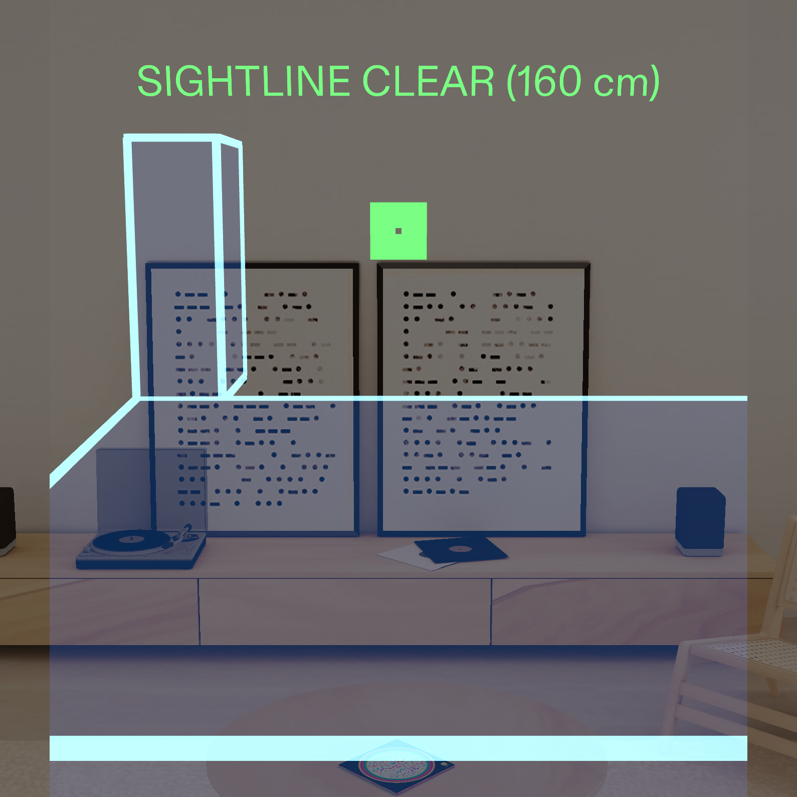
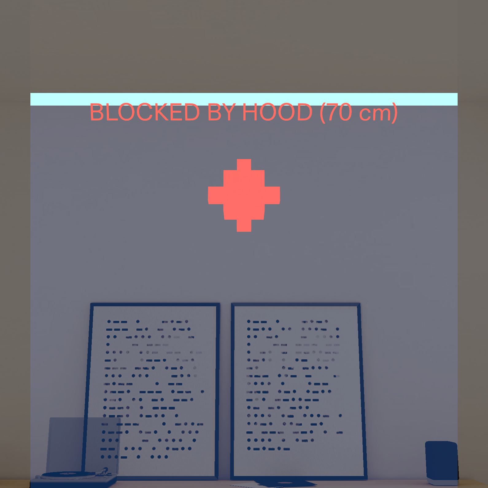
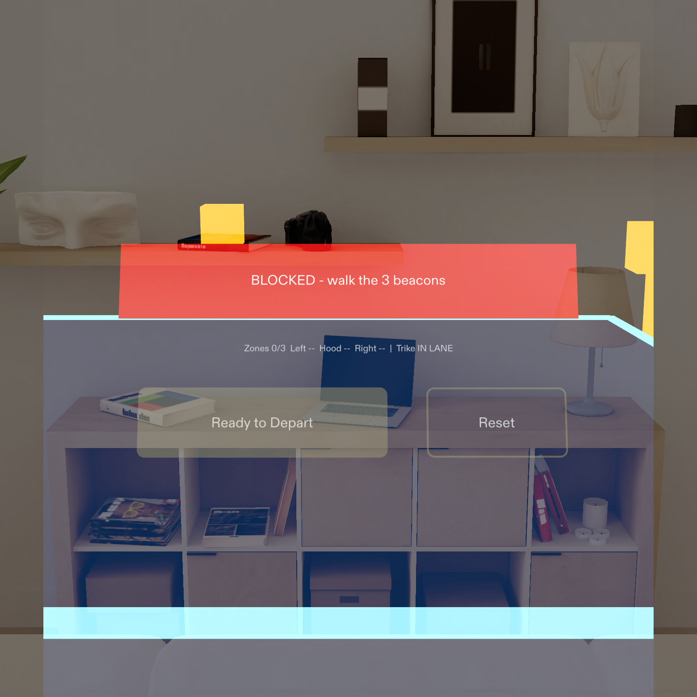
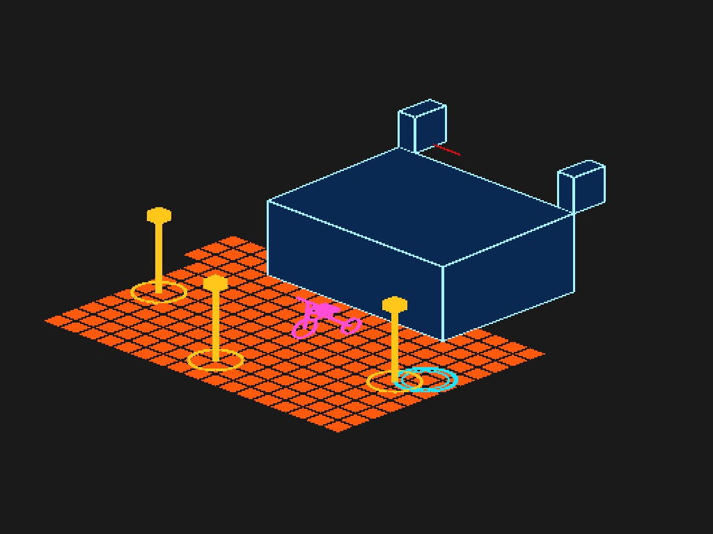
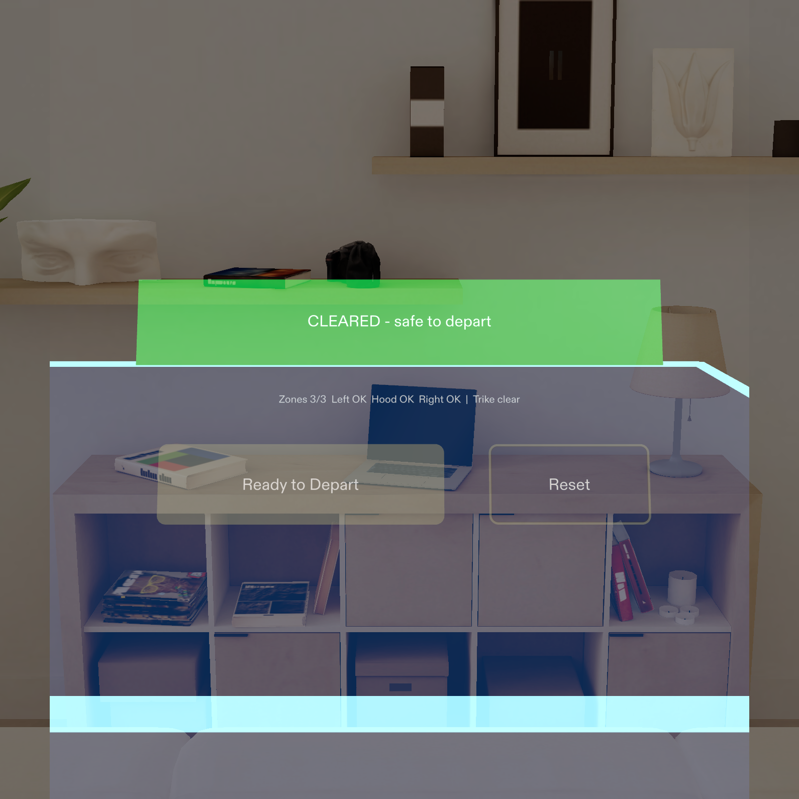

# Circle Check+ — Learn AR with SPECS (Round 2) Devpost Submission

## Tagline
Crouch in front of a life-size AR SUV to feel what a toddler sees—and cannot see—then walk the 3 front blind zones before you drive away.

## Inspiration
Drivers know SUVs and pickup trucks have tall hoods, yet frontover accidents still happen in home driveways and parking lots. A flat safety brochure shows shaded cones on paper, but paper never makes your own body feel **sightline reciprocity**: the moment you crouch to a toddler's eye height (~70 cm) and lose sight of the driver behind the hood ridge, the driver loses sight of you too.

A phone screen cannot anchor a life-size vehicle to your floor and react to your actual standing and crouching eye height. We built **Circle Check+** for **Snap SPECS** so your own posture and footsteps turn an abstract diagram into an unmistakable physical memory.

## Who it's for
- **Parents and caregivers** teaching young children why standing in front of a parked SUV or pickup is unsafe even when the car looks close.
- **New SUV, pickup, and delivery-van drivers** building the real-world habit of walking the front perimeter ("Circle Check") before shifting into drive.
- **Driver-safety instructors and community workshops** demonstrating front blind zones indoors at true 1:1 scale without needing a parking lot or a real vehicle.

## What it does
**Circle Check+** places a full-size luminous SUV front cab right on your room floor and walks you through three clear moments:

*Full 3-act walkthrough captured in Lens Studio SPECS 27 Preview: standing clear vs. crouching blocked, departure blocked from the driver seat, and walkaround cleared after moving the tricycle.*

1. **Feel the blind spot with your own height (Act 1 — Stand vs. Crouch)**
   Stand in front of the bumper at adult eye height (160 cm): a bright green sightline connects your eyes straight to the driver's eye position. Now crouch down to toddler height (70 cm)—the sightline snaps against the hood ridge with a red 3D cross showing the exact point where the hood cuts off visibility.
   
   *Standing at adult eye height (160 cm) in front of the bumper: direct green sightline to the driver's eyes.*
   
   *Crouching to toddler height (70 cm): the sloped hood cuts off the sightline and lights a red 3D hit marker on the ridge.*

2. **Try to depart without checking (Act 2 — Blocked Departure)**
   Step back into the driver seat and tap **Ready to Depart** without walking around first. The cabin banner turns crimson and lights three golden walkaround beacons around the front corners—and if you try to reach through the hood from the seat to move the hidden child tricycle, the Lens refuses the grab so you cannot skip the walkaround.
   
   *Inside the driver seat before inspection: Ready to Depart is blocked and three golden beacons guide you out of the cab.*
   
   *Top-down view of the 1:1 SUV blind-zone footprint and the hidden 50 cm child tricycle sitting directly ahead of the hood.*

3. **Walk the perimeter and clear the lane (Act 3 — Walkaround & Safe Departure)**
   Walk around the left A-pillar, front bumper, and right A-pillar. Each blind zone shifts from red-orange to green only as your real forward view sweeps across it unoccluded. Once you spot the neon-pink tricycle up close, drag it into the cyan Safe Parking Ring beside the lane, step back into the seat, and press **Ready to Depart** to clear the check.
   
   *After walking all three front zones green and moving the tricycle into the cyan Safe Parking Ring, the departure lane is clear.*
   
   *Back in the driver seat after completing the walkaround: the status banner turns green (CLEARED - safe to depart).*

## How we built it
- **Clean-room Lens Studio 5.25.0 + v4.0 Packages**: Planned with the Devpost `plan-lens` skill ([`devpost/design-brief.md`](https://github.com/GGGODLIN/specs-circle-check/blob/main/devpost/design-brief.md)) and built from scratch using Snap CLAD, Lens Studio MCP, `InteractionKit 4.0.0`, `UIKit 4.0.0`, `Motion 4.0.0`, `Icons 4.0.0`, and `Leaf 4.0.0`.
- **Single Immutable Geometry Source (`VehicleGeometrySpec`)**: A representative full-size SUV front envelope (200 cm wide, 112 cm bumper lip sloping to 118 cm hood trailing edge, 152 cm driver eye height) is defined once in pure TypeScript. Both the 3D `MeshBuilder` occluder panels (`DepthWrite: true` + bright cyan additive-display wireframes) and exact symmetric segment-triangle raycasts read this same frozen geometry, preventing any visual/math drift.
- **Zero-Rebuild Floor Classification**: At startup, the 18 × 18 (20 cm) front floor grid is classified once at 70 cm child height into 3 static floor meshes (748 vertices total) that swap materials on state transitions without rebuilding meshes every frame.
- **Dual-Layer Verification (Offline Core + Live LEAF)**:
  - **Offline spatial core (`Vitest + fast-check`)**: `17 / 17` tests passing, verifying sightline reciprocity symmetry (`P1`), zero false departure clearance (`P3`), and strict forward `-Z` rectangular `37° × 32°` frustum occlusion (`P4`), plus test-local mutation checks.
  - **Live Lens Studio `LEAF 4.0` (`SPECS 27` Interactive Preview)**: `3 / 3` Done Criteria scenarios (`act1-sightline-reciprocity`, `act2-blocked-departure-guard`, `act3-walkaround-trike-depart`) plus a post-Reset consecutive `act3` re-run all pass with zero test-only bypass flags.

## Challenges we ran into
- **`DeviceTracking (World)` camera lock in automated `LEAF` tests**: Early probing showed `DeviceTracking` snaps direct camera position writes back on the next frame. Shifting `VehicleRoot` inversely during automated scenarios kept manual `WASD` walkarounds and `LEAF` tests running through the exact same spatial math pipeline with zero test backdoors.
- **Additive optics legibility**: Dark fills disappear on SPECS waveguides and default UIKit text lacked contrast until we enabled `useTextColorOverride`, added high-contrast crimson/emerald backing bars, and rendered the 8 cm red hit-cross last so the bumper never obscured the hood intersection.
- **Preventing through-hood grab exploits**: Because ray interactors can reach through solid meshes, we enforced physical reach (`<= 150 cm`) and unoccluded line-of-sight directly inside `CircleCheckCore`'s grab gate (`OUT_OF_REACH` from the driver seat).

## Accomplishments that we're proud of
- **Zero-backdoor honesty**: Manual preview walkarounds and automated LEAF runs execute the exact same pure TypeScript spatial core.
- **Clear proof boundary**: We separate **logic proven** (Lens Studio 5.25.0 Preview, `3/3` LEAF + Reset, `17/17` Vitest/`fast-check`) from **feel unproven** (real SPECS waveguide brightness, optical hand-tracking drag comfort, and real-room crouch ergonomics on physical hardware).

## What we learned
- Designing for additive AR waveguides means treating brightness, wireframes, and render order as primary spatial ergonomics—not late polish.
- Separating engine-independent spatial math with property-based tests before wiring 3D meshes caught subtle forward-frustum sign bugs (`camZ < 0` vs `Math.abs(dot)`) before opening Lens Studio.

## What's next for Circle Check+
- Testing optical brightness, real hand-tracking drag, and crouch comfort on physical SPECS glasses.
- Adding selectable real-vehicle dimension profiles (compact sedan vs. full-size SUV vs. pickup vs. delivery van) on the same `VehicleGeometrySpec` schema so drivers can compare hood heights side by side.

---

## Devpost Portal Metadata Checklist
- **Built With**: `lens-studio`, `snap-specs`, `typescript`, `interaction-kit`, `uikit`, `leaf`, `vitest`, `fast-check`, `ar`
- **Public Repository**: `https://github.com/GGGODLIN/specs-circle-check`
- **Demo Video (< 3 min, public YouTube)**: `https://youtu.be/oDSh0mqP54c` (`68.83 s`, `1920×1080 @ 30fps`)
- **Design Brief Included**: `devpost/design-brief.md` (`status: approved`)
- **Clean-Room Round 2 Provenance**: Repository initialized fresh after Round 2 launch (`2026-11-10`); zero custom code or assets copied from Round 1.

### Image Gallery Captions (Devpost Upload Order)
1. `circle-check-flow.gif` — Full 3-act walkthrough in Lens Studio SPECS 27 Preview: standing clear vs. crouching blocked, departure blocked in seat, and walkaround cleared.
2. `act1-standing-clear.png` — Act 1 (160 cm standing): live green sightline connects your eyes straight to the driver's eye point over the bumper.
3. `act1-crouch-blocked.png` — Act 1 (70 cm toddler height): crouching snaps the sightline against the sloped hood with a red 3D hit marker.
4. `act2-cockpit-blocked.png` — Act 2 (driver seat): Ready to Depart is blocked before inspection and lights three golden walkaround beacons.
5. `act3-walkaround-green-trike-cleared.png` — Act 3 (walkaround cleared): all three blind zones swept green and the hidden child tricycle moved into the Safe Parking Ring.
6. `act3-cockpit-cleared.png` — Act 3 (safe to depart): returning to the driver seat unlocks CLEARED - safe to depart.
