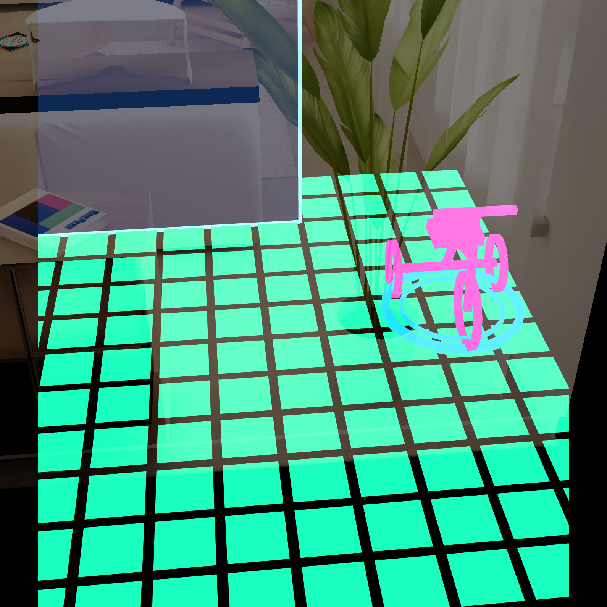

# Circle Check+ — Learn AR with SPECS (Round 2) Devpost Submission

## Tagline
A 1:1 scale AR SUV front blind-spot and pre-departure walkaround trainer for Snap SPECS — prove sightline reciprocity by crouching to toddler height, sweep all 3 blind zones, and clear the hidden tricycle before departing.

## Inspiration
Every year, frontover collisions happen because drivers cannot see low obstacles (50–100 cm tall toddlers or bikes) directly ahead of tall SUV and light-truck hoods. Flat 2D safety diagrams tell you a blind spot exists, but they never let your own body feel **sightline reciprocity**: the exact moment your eyes drop to 70 cm child height and you lose sight of the driver's eyes behind the hood ridge, the driver loses sight of you too.

We built **Circle Check+** specifically for **Snap SPECS**: a 1:1 world-anchored vehicle front in your room where your physical eye height (`160 cm` vs. `70 cm`) and real footsteps around the bumper (`37° × 32°` SPECS frustum) replace passive charts with an honest, physical pre-departure safety check.

## What it does
**Circle Check+** runs a tight three-act spatial loop anchored to the room floor (`localY = 0`, 1:1 centimeter scale):

1. **Act 1 — Stand vs. Crouch Sightline Reciprocity**:
   Stand `100 cm` ahead of the 1:1 luminous wireframe SUV bumper (`x = -45, z = +100 cm`). At `160 cm` standing eye height, a bright green live sightline beam connects your eyes to the driver's eye point (`SIGHTLINE CLEAR (160 cm)`). Crouch (`Q/E`) down to `70 cm` toddler height — the beam snaps against the sloped hood ridge (`y ≈ 91.5 cm` grazing height) with an `8 cm` bright red 3D cross hit marker (`BLOCKED BY HOOD (70 cm)`).
   
   

2. **Act 2 — Blocked Departure & Through-Hood Grab Guard**:
   Step into the driver seat (`(-45, 152, -195 cm)`) to reveal a compact cabin dashboard strip positioned strictly behind the hood trailing edge (`z = -152 cm`). Pressing **Ready to Depart** before inspecting turns the banner crimson (`BLOCKED - walk the 3 beacons`) and illuminates 3 golden `110 cm` walkaround beacons. Attempting to cheat by grabbing the hidden `50 cm` neon-pink child tricycle through the hood from the driver seat fails closed at the product interaction gate (`OUT_OF_REACH`, tricycle stays locked at `(+15, 0, +55 cm)`).
   
   

3. **Act 3 — 3-Zone Walkaround Frustum Sweep, Safe-Ring Drag & Cleared Departure**:
   Walk around the front bumper (`WASD`) sweeping SPECS's strict forward `-Z` rectangular `37° tall × 32° wide` frustum over `FrontLeftAPillar`, `FrontCenterHood`, and `FrontRightAPillar`. Each zone flips from bright orange-red to cyan-green at `>= 60%` unoccluded coverage. Stand within `150 cm` unoccluded of the child tricycle, single-hand Y-locked drag it into the glowing cyan Safe Parking Ring (`(+150, 0, +70 cm)`, `r = 25 cm`), and return to the driver seat to press **Ready to Depart** (`CLEARED - safe to depart`). Pressing **Reset** restores a completely clean initial state.
   
   

## How we built it
- **Clean-room Lens Studio 5.25.0 + v4.0 Packages**: Built from scratch on `Lens Studio 5.25.0` using `InteractionKit 4.0.0`, `UIKit 4.0.0`, `Motion 4.0.0`, `Icons 4.0.0`, and `Leaf 4.0.0`, guided by our approved [`devpost/design-brief.md`](https://github.com/GGGODLIN/specs-circle-check/blob/main/devpost/design-brief.md) (`plan-lens`).
- **Single Immutable Geometry Source (`VehicleGeometrySpec`)**: Both 3D `MeshBuilder` occluder panels (`DepthWrite: true` + luminous cyan wireframes tuned for additive optics) and exact symmetric segment-triangle raycasts read one frozen `OccluderPrimitive[]` array — zero duplicated `@input` constants and zero geometry drift.
- **Zero-Rebuild Static Floor Grid**: At boot, `classifyFootprintCells` evaluates the `18 × 18` (`20 cm`) front footprint at fixed `70 cm` child height and builds 3 static floor meshes (`748` total vertices, well below `UInt16` limits) that swap material appearance without per-frame mesh rebuilds.
- **Dual-Layer Verification (Offline PBT + Live LEAF)**:
  - **Offline Core (`Vitest + fast-check`)**: `17 / 17` tests passing, proving `P1` sightline reciprocity symmetry, `P3` zero false departure clearance (immediate revert to `IDLE` on lane re-entry or seat exit), and `P4` strict forward `-Z` frustum & occlusion honesty, calibrated with test-local mutation controls.
  - **Live Lens Studio `LEAF 4.0` (`SPECS 27` Interactive Preview)**: `3 / 3` Done Criteria scenarios (`act1-sightline-reciprocity`, `act2-blocked-departure-guard`, `act3-walkaround-trike-depart`) plus a consecutive `act3` post-Reset re-run all pass (`fail-fast`, zero test-only bypass flags).

## Challenges we ran into
- **`DeviceTracking (World)` camera lock during automated `LEAF` runs**: Our early probe proved `DeviceTracking` overwrites direct camera `setWorldPosition` on the next frame (`141.86 cm` snap-back). Moving `VehicleRoot` inversely during `LEAF` scenarios kept both manual `WASD` and automated `LEAF` on the exact same `camLocalPos` math pipeline without adding test backdoors.
- **Additive optics readability**: Dark colors vanish on SPECS waveguides and early status text defaulted to white until we enabled UIKit `useTextColorOverride`, added high-contrast crimson/emerald status backing bars, and rendered the `8 cm` crouch hit-cross last so the bumper never obscured the hood hit point.
- **Preventing through-hood grab exploits**: Because ray-based interactors can fall through occluders, we enforced reach (`<= 150 cm`) and unoccluded line-of-sight directly in `CircleCheckCore`'s drag gate so driver-seat grabs fail closed both manually and under `DefaultLeafInteractor`.

## Accomplishments that we're proud of
- **Zero-backdoor honesty**: Every LEAF pass and manual walkaround runs through the exact same pure TypeScript spatial core verified by property-based tests.
- **Transparent proof boundary**: We explicitly distinguish **logic proven** (Lens Studio 5.25.0 Preview, `3/3` LEAF + Reset, `17/17` Vitest/`fast-check`) from **feel unproven** (physical SPECS waveguide brightness, optical hand tracking, and physical crouch comfort on real glasses).

## What we learned
- Designing for additive AR waveguides means treating brightness, wireframes, and render order as first-class spatial ergonomics — not afterthoughts.
- Writing an engine-independent spatial core with Conditional PBT before wiring 3D meshes eliminated subtle sign/frustum bugs (`camZ < 0` vs `Math.abs(dot)`) before Lens Studio even opened.

## What's next for Circle Check+
- Testing optical brightness, real hand-tracking drag comfort, and room-scale crouch ergonomics on physical SPECS hardware.
- Adding selectable vehicle profiles (compact sedan vs. full-size pickup vs. delivery van) using the same `VehicleGeometrySpec` schema so learners can compare hood heights side by side.

---

## Devpost Portal Metadata Checklist
- **Built With**: `lens-studio`, `snap-specs`, `typescript`, `interaction-kit`, `uikit`, `leaf`, `vitest`, `fast-check`, `ar`
- **Public Repository**: `https://github.com/GGGODLIN/specs-circle-check`
- **Demo Video (< 3 min, public YouTube)**: `https://youtu.be/owwydtpAjEU` (`68.46 s`, `1920×1080 @ 30fps`, English, zero live human camera/voiceover)
- **Design Brief Included**: `devpost/design-brief.md` (`status: approved`)
- **Clean-Room Round 2 Provenance**: Repository initialized fresh after Round 2 launch (`2026-11-10`); zero custom code or assets copied from Round 1.
